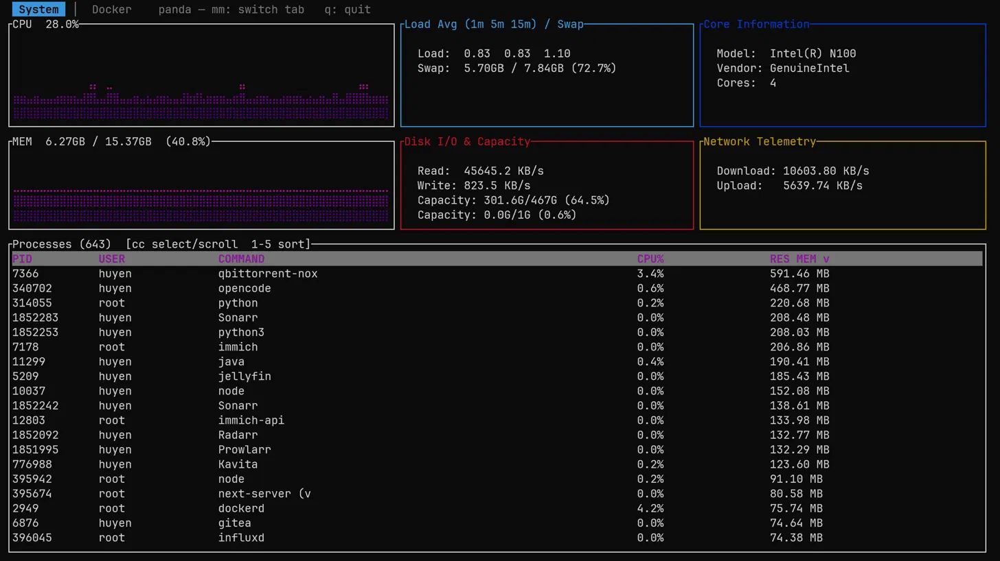
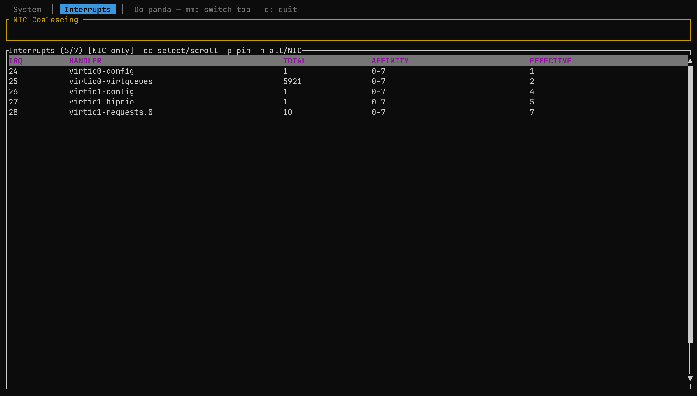
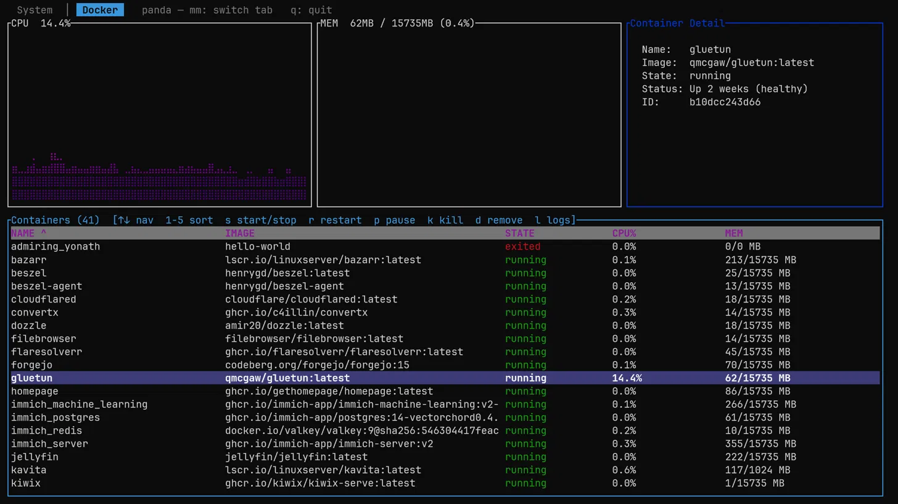

# panda

A terminal UI for **Linux system monitoring** and **Docker container control**, written in Rust with [ratatui](https://github.com/ratatui/ratatui) and [bollard](https://github.com/fussybeaver/bollard).

panda has three tabs:

- **System** — live CPU and memory gradient charts, a per-core utilization heatmap, NUMA node topology (per-node memory and CPU locality), hugepage pools + transparent-hugepage mode, load average, swap, disk I/O & capacity, network throughput, CPU info, and a process table (sorted by resident memory) with per-process CPU affinity and one-key **core pinning**.
- **Interrupts** — per-IRQ CPU counts, handler, allowed and effective affinity, and one-key **NIC IRQ pinning** for low-latency network tuning.
- **Docker** — a selectable container table with per-container CPU/memory charts, container detail, and lifecycle controls.





## Requirements

- **Linux only.** All system metrics come from the `/proc` and `/sys` pseudo-filesystems. On other platforms the system tab shows zeros.
- **Rust** (edition 2024) toolchain to build.
- For the Docker tab: a running Docker daemon and access to its socket (`/var/run/docker.sock`). Add your user to the `docker` group, or run panda with elevated privileges. If the socket is unreachable, the Docker tab shows an "unavailable" panel instead of failing.

## Build & run

```bash
cargo build --release
./target/release/panda
```

Or during development:

```bash
cargo run
```

## Keybindings

### Global
| Key | Action |
|-----|--------|
| `mm` | Cycle through the System, Interrupts, and Docker tabs (press `m` twice) |
| `q` | Quit |
| `Esc` | Close the current dialog / exit the current mode |

### System tab
| Key | Action |
|-----|--------|
| `cc` | Enter / exit process **select mode** (press `c` twice) |
| `↑` / `↓` | Scroll the selection through the full list (wraps around) |
| `1`–`5` | Sort by PID / USER / COMMAND / CPU% / RES MEM (press again to flip direction) |
| `0` | Reset sort to default (RES MEM, descending) |
| `p` | **Pin** the selected process to the least-loaded CPU core (`sched_setaffinity`) |
| `k` | Kill the selected process (asks for confirmation) |

The active sort column is marked with a `^` (ascending) or `v` (descending) arrow in the header, and a scrollbar on the right shows the cursor position.

### High-performance computing features

panda includes a set of low-latency / HPC-oriented monitoring and control tools in the System tab:

- **Per-core utilization heatmap** — the "CPU Cores / Affinity" panel renders each logical core as a `NN▇` block colored by load (`·` idle → `▂`/`▄` busy → `▆`/`█` saturated).
- **CPU affinity + core pinning** — every process row shows its allowed CPUs in the **AFF** column (from `Cpus_allowed_list`). In select mode, press **`p`** to pin the selected process to the **least-loaded core** via `sched_setaffinity`.
- **NUMA topology** — the same panel lists each memory node with used/total memory and its local CPU ranges (e.g. `N0  15.3/15.3G (41%)  cpus 0-21`), so you can keep a process and its memory on the same node.
- **Hugepages & THP** — the "Load / Swap / HugePages" panel shows the transparent-hugepage mode (`always` / `madvise` / `never`) and every hugepage pool (2 MB, 1 GB) with free, reserved, and surplus page counts and total pool size.
- **Per-interface network stats** — the "Network / Clock Sync" panel shows total RX/TX throughput, TCP retransmit count, and, per active interface, RX/TX KB/s plus cumulative error, drop, and multicast counters (all live from `/proc/net/dev` and `/proc/net/snmp`).
- **Clock sync status** — the same panel reports the PLL/NTP time offset via the `adjtimex(2)` syscall and the first PTP hardware clock (`/sys/class/ptp/ptp0`), for checking drift on a timing-critical host.
- **NIC IRQ affinity + balancing** — the dedicated **Interrupts** tab parses `/proc/interrupts` for every numbered IRQ with per-core counts, its handler name, the allowed affinity (`/proc/irq/N/smp_affinity_list`) and the *effective* core it is currently served on. A NIC-only filter highlights data-path interrupts (virtio/eth/en/ena/mlx/ixgbe…). In select mode, press **`p`** to pin the selected IRQ to the least-loaded of its allowed cores by writing `/proc/irq/N/smp_affinity_list` — the same isolate-network-IRQs-from-trading-cores tuning low-latency teams do daily (root needed; falls back to an in-app sudo prompt). A read-only **NIC coalescing** strip above the table shows `ethtool -c` values (`rx-usecs`, `tx-usecs`, adaptive…) for the busiest interface that supports coalescing, so you can see whether interrupt coalescing is enabled without leaving the app.

### Interrupts tab
| Key | Action |
|-----|--------|
| `cc` | Enter / exit IRQ **select mode** |
| `↑` / `↓` | Move the selection (wraps around) |
| `p` | **Pin** the selected IRQ to the least-loaded of its allowed cores |
| `n` | Toggle the filter between **NIC-only** interrupts and **all** interrupts |
| `0` | Reset: back to the NIC-only filter |
| `Esc` | Exit select mode |
- **Multicast membership** — the "Network / Clock Sync" panel also tallies IPv4 (IGMP, from `/proc/net/igmp`) and IPv6 (MLD, from `/proc/net/igmp6`) group memberships and the number of joined interfaces, a quick read-only check for multicast trading feeds.

NIC coalescing requires both `ethtool` and driver support for `ethtool -c`. Installing the tool alone does not guarantee support, especially on virtual interfaces. Panda tries interfaces in traffic order, excluding loopback, displays the first supported interface, and shows query errors when none support coalescing.

Pinning is the only interactive HPC action. It targets the selected process and requires ownership (root for other users' processes); failures surface as an in-panel message without affecting the rest of the UI.

### Docker tab
| Key | Action |
|-----|--------|
| `↑` / `↓` | Scroll the container selection (wraps around) |
| `1`–`5` | Sort by NAME / IMAGE / STATE / CPU% / MEM (press again to flip direction) |
| `0` | Reset sort to default (NAME, ascending) |
| `s` | Start the container if stopped, stop it if running |
| `r` | Restart the container |
| `p` | Pause / unpause the container |
| `k` | Kill the container (asks for confirmation) |
| `d` | Remove the container, forced (asks for confirmation) |
| `l` | View the last logs; `↑`/`↓` scroll, `Esc`/`l` close |

## Destructive actions & privileges

panda can **kill processes** and **kill/remove Docker containers**. These are confirmed via a bottom action bar before running.

- **Process kill** uses `SIGKILL`. Killing a process you own needs no extra privilege. If the kernel returns `EPERM` (a process owned by another user, e.g. root), panda shows an in-app password bar and runs `sudo -S kill -9 <pid>`.
  - **Security note:** this captures your sudo password into application memory for the duration of that single action (it is cleared immediately after use). If you prefer not to type your password into panda, run the whole program under `sudo` instead and skip the prompt.
  - panda will not kill its own process.
- **Docker actions** target the container's stable **ID** (not its display name) and are gated only by access to the Docker socket — there is no per-action password prompt.

## Notes

- CPU% in tables is the raw value: process CPU is capped at 100%; Docker container CPU can exceed 100% on multi-core hosts. The gradient charts are normalized to 0–100% and are therefore capped.
- Resident memory uses the system page size (`sysconf(_SC_PAGESIZE)`).
